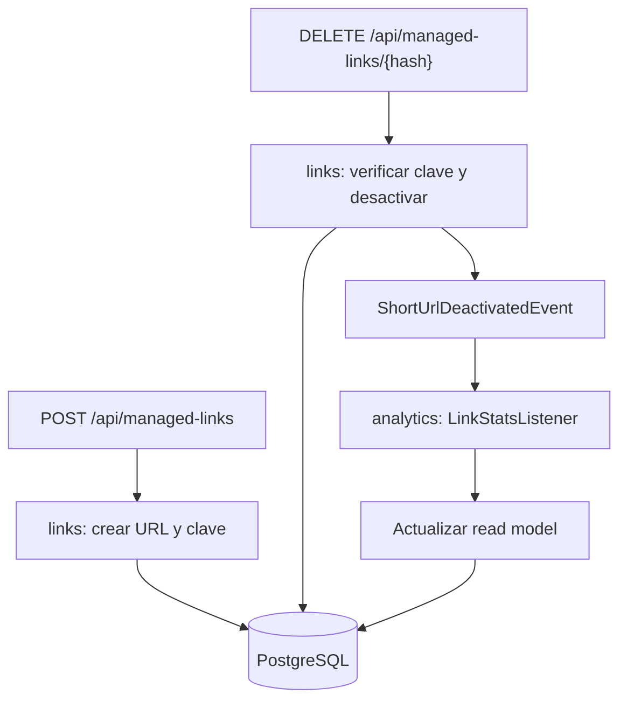

# ADR 0004: URL management with secure deactivation and module events

- **Status:** Proposed
- **Date:** 2026-10-23
- **Deciders:** Group K (feature 0008: URL Management / Deactivation)

## Context

The URL shortener must allow the creator of a short URL to deactivate it with a management key. A deactivated URL must no longer redirect: `GET /{hash}` returns `410 Gone`. The seed endpoints (`POST /api/link`, `GET /{hash}`, and `GET /api/stats/{hash}`) must retain their existing successful response contracts. The product runs two application replicas behind nginx, sharing PostgreSQL.

Feature 0008 has weight **13**, so it needs a new domain event consumed by another Spring Modulith module. The base application already uses the closed `links`, `clicks`, and `analytics` modules and a ports-and-adapters structure enforced with jMolecules. URL expiration (feature 0009) and redirect caching (feature 0006) are separate workstreams and must not be broken by this feature.

## Decision

1. **Ownership and module boundaries.** `links` owns managed-link creation, management keys, the authoritative deactivation state, and redirect behavior. `analytics` consumes a new deactivation event and updates an internal read-model status. No module imports another module's `application`, `domain`, or `adapters` packages.

2. **HTTP contract.** Add `POST /api/managed-links` to create a manageable link without changing the existing `POST /api/link` JSON contract. It accepts a form `url` and responds with `201 Created`, a `Location` pointing to the short URL, and JSON containing the short URL, hash, and **one-time** `managementKey`. Set `Cache-Control: no-store` on this response. Add `DELETE /api/managed-links/{hash}`, taking the key in `Authorization: Bearer <managementKey>`. It returns `204 No Content` when successfully deactivated (and on an authorized repeat), `403 Forbidden` for a missing or invalid key, and `404 Not Found` for an unknown hash. New error responses use RFC 9457 `ProblemDetail`. A deactivated `GET /{hash}` returns `410 Gone` via `ProblemDetail`; an active link still redirects with `307` and its original `Location`.

3. **Capability-key storage.** Generate a high-entropy management key from 32 random bytes using `SecureRandom`, encoded as URL-safe Base64 without padding. Persist only its SHA-256 digest in `short_url` (`managementKeyHash`), never the plaintext key. The key is not included in application logs or events. Existing links without a management key cannot be deactivated through this API. This design uses JDK cryptography and Spring's existing dependencies; **no new library is required**.

4. **Deactivation and concurrency.** Use a soft-deactivation timestamp (`deactivatedAt`) in the `links` domain and database, rather than deleting the URL. Make the update conditional and atomic in PostgreSQL, requiring a matching key digest and `deactivatedAt IS NULL`. Only the transaction that changes active to deactivated may publish the event. A duplicate authorized DELETE does not publish a second event. The database is the source of truth on both replicas; never keep the deactivation state only in process memory. Redirect checks this state before publishing a click event.

5. **New cross-module event.** Define `ShortUrlDeactivatedEvent(hash, deactivatedAt)` in the public base package `es.unizar.urlshortener.links`. `links` publishes it when deactivation succeeds. `analytics` consumes it using `@ApplicationModuleListener` and marks the corresponding `LinkStats` read model as deactivated. The consumer must be idempotent and handle the possibility that creation and deactivation events are processed in a different order (for example, via upsert). The existing public JSON response of `GET /api/stats/{hash}` remains unchanged. The listener is eventually consistent within one application instance; the shared database stores durable state. Cross-replica cache invalidation and external broker delivery are **not** claimed by this Level-3 feature; feature 0006 may subscribe to this event when implemented.

6. **Ports and adapters.** Add management use-case ports to `links.application`, keep HTTP handling in `links.adapters.web` and database access in `links.adapters.persistence`. Extend the current `ShortUrl` domain and `ShortUrlEntity` mappings without moving code between modules or replacing jMolecules stereotypes.

## Consequences

- **Positive:** Seed endpoints remain compatible, the key cannot be recovered from database contents, duplicate deactivations do not produce duplicate events, and both application replicas consult the same authoritative PostgreSQL state.
- **Trade-offs:** A separate managed-creation endpoint must be documented. Analytics can briefly lag the authoritative deactivation state because Modulith listeners are asynchronous. In-process events do not provide cross-JVM fan-out; the eventual feature-0006 cache strategy must address this separately.
- **Integration:** Coordinate with the owner of feature 0006 to reuse the deactivation event for future cache invalidation rather than introduce a competing event. Avoid changes to the expiry scheduler owned by feature 0009.

## Alternatives considered

| Alternative | Why rejected |
| --- | --- |
| Add `managementKey` to the existing `POST /api/link` JSON body | Would change the seed success representation; a dedicated endpoint preserves the original contract. |
| Store management keys as plaintext | Exposes control of all links if the database is read; a high-entropy capability can be verified using only its digest. |
| Physically delete the short URL | Loses its deactivation status and risks treating a deliberately disabled URL as an unknown `404`; soft-deactivation supports `410`. |
| Check then update in separate database operations | Two simultaneous requests could both observe an active link and both publish a deactivation event. |
| Directly call `analytics` internals from `links` | Breaks the closed Spring Modulith module boundaries and the hexagonal architecture. |
| Use an external broker for deactivation | Unnecessary for the chosen weight-13 / Level-3 PoC; externalized events belong to a Level-4 design. |

## Evidence (defence)

Tests below are **planned** as part of feature 0008, not yet present in the repository when this ADR is drafted.

- [ ] **Code / PR:** Link the feature-0008 Pull Request once opened.
- [ ] **End-to-end integration:** `UrlManagementFlowTests` tests creation, authorization, `307` before deactivation, `410` afterwards, idempotent deactivation and the consumed event in `analytics`.
- [ ] **Feature test (Windows):** `./gradlew.bat test --tests "es.unizar.urlshortener.UrlManagementFlowTests"`
- [ ] **Module integrity:** `./gradlew.bat test --tests "es.unizar.urlshortener.ModularityTests"`
- [ ] **Full quality gate:** `./gradlew.bat check`
- [ ] **Product with two replicas:** `docker compose up --build`, then verify the flow through `http://localhost:8080`.

# Architecture diagram

