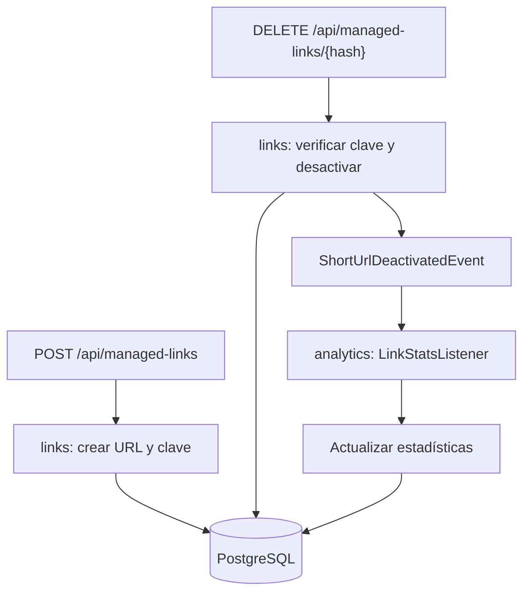

# ADR 0004: Gestión de URLs con desactivación segura y eventos entre módulos

- **Estado:** Aceptado
- **Fecha:** 2026-10-23
- **Responsables:** Grupo K (feature 0008: URL Management / Deactivation)

## Contexto

Se necesita permitir que el creador de una URL corta pueda desactivarla utilizando una clave de gestión generada durante su creación. Una vez desactivada, la URL debe dejar de redirigir y `GET /{hash}` debe devolver `410 Gone`.

Los endpoints existentes (`POST /api/link`, `GET /{hash}` y `GET /api/stats/{hash}`) deben mantener su comportamiento. La aplicación utiliza dos réplicas detrás de Nginx que comparten una base de datos PostgreSQL.

La funcionalidad 0008 tiene un peso de 13, por lo que se necesita un nuevo evento de dominio que sea consumido por otro módulo de Spring Modulith. La aplicación ya está organizada en los módulos `links`, `clicks` y `analytics`, utilizando una arquitectura de puertos y adaptadores con jMolecules.

También se debe mantener la compatibilidad con la caducidad de URLs (0009) y la caché de redirecciones (0006), que se desarrollan por separado.

## Decisión

1. **Responsabilidad de los módulos.** El módulo `links` se encarga de crear las URLs administrables, generar y comprobar las claves de gestión, guardar el estado de desactivación y controlar las redirecciones. El módulo `analytics` recibe el evento de desactivación y actualiza su registro de estadísticas. Se mantiene la separación entre módulos sin acceder directamente a los paquetes internos `application`, `domain` o `adapters` de otros módulos.

2. **Endpoints HTTP.** Se añade `POST /api/managed-links` para crear URLs administrables sin modificar el comportamiento de `POST /api/link`. Recibe el parámetro `url` y devuelve `201 Created`, una cabecera `Location` con la URL corta y un JSON con `hash`, `url` y `managementKey`. La clave solo se devuelve durante la creación y se utiliza `Cache-Control: no-store` para evitar que la respuesta se almacene en caché.

   Para desactivar una URL se añade `DELETE /api/managed-links/{hash}`, que recibe la clave mediante `Authorization: Bearer {managementKey}`. Devuelve `204 No Content` cuando la desactivación se realiza correctamente o cuando se repite con una clave válida, `403 Forbidden` si la clave falta o es incorrecta y `404 Not Found` si la URL no existe. Los errores utilizan `ProblemDetail`.

   Una URL desactivada devuelve `410 Gone` al intentar acceder a ella. Las URLs activas mantienen la redirección `307` con la cabecera `Location` correspondiente.

3. **Almacenamiento de la clave de gestión.** Se genera una clave aleatoria de 32 bytes mediante `SecureRandom` y se codifica en Base64 compatible con URLs. En PostgreSQL solo se almacena su hash SHA-256 en el campo `managementKeyHash`, sin guardar la clave original.

   La clave no se incluye en los eventos ni en los registros de la aplicación. Las URLs creadas mediante el endpoint original, que no tienen clave de gestión, no se pueden desactivar mediante este mecanismo.

   Se utilizan las herramientas criptográficas de Java, por lo que no hace falta añadir nuevas dependencias.

4. **Desactivación y concurrencia.** En lugar de eliminar físicamente una URL, se guarda la fecha de desactivación en `deactivatedAt`.

   Se utiliza una actualización condicional y atómica en PostgreSQL, comprobando que la clave coincide y que `deactivatedAt IS NULL`. Así, si dos peticiones intentan desactivar la misma URL al mismo tiempo, solo una realiza el cambio de estado y publica el evento.

   Si se repite una petición con la clave correcta, se devuelve `204`, pero no se vuelve a publicar el evento. PostgreSQL mantiene el estado compartido entre las réplicas y se comprueba la desactivación antes de registrar un nuevo clic.

5. **Evento entre módulos.** Se define `ShortUrlDeactivatedEvent(hash, deactivatedAt)` en el paquete público `es.unizar.urlshortener.links`.

   Cuando se desactiva una URL, `links` publica el evento y `analytics` lo recibe mediante `@ApplicationModuleListener`. El consumidor actualiza la fecha de desactivación en sus estadísticas, sin modificar la respuesta pública de `GET /api/stats/{hash}`.

   Se comprueba que el procesamiento sea idempotente y que la fecha se conserve aunque los eventos de creación, clic y desactivación lleguen en distinto orden.

   El procesamiento se realiza de forma asíncrona dentro de Spring Modulith y el estado se conserva en PostgreSQL. Los eventos locales no se propagan automáticamente entre distintas instancias de la aplicación. La invalidación de caché entre réplicas corresponde a la integración con la funcionalidad 0006.

6. **Puertos y adaptadores.** Se añaden los casos de uso necesarios en `links.application`, manteniendo los controladores HTTP en `links.adapters.web` y el acceso a PostgreSQL en `links.adapters.persistence`.

   Se amplían las clases `ShortUrl` y `ShortUrlEntity` para incorporar la clave de gestión y la fecha de desactivación, conservando la arquitectura existente y las anotaciones de jMolecules.

## Consecuencias

- **Positivas:** Los endpoints originales mantienen su comportamiento. Las claves de gestión no se guardan en texto plano, las desactivaciones repetidas no generan eventos duplicados y ambas réplicas utilizan PostgreSQL como fuente de información compartida.
- **Limitaciones:** Se introduce un endpoint adicional para crear URLs administrables. El módulo `analytics` puede tardar un breve intervalo en reflejar la desactivación porque procesa los eventos de forma asíncrona.
- **Integración:** La caché de la 0006 debe invalidarse cuando una URL se desactive para evitar redirecciones antiguas. También se debe mantener la compatibilidad con el proceso de caducidad de la 0009.

## Alternativas consideradas

| Alternativa | Motivo por el que se descarta |
| --- | --- |
| Añadir `managementKey` a la respuesta de `POST /api/link` | Modificaría la respuesta del endpoint original. Se utiliza otro endpoint para mantener la compatibilidad |
| Guardar las claves de gestión en texto plano | Permitiría recuperar las claves si se accede a la base de datos. Se almacena únicamente su hash SHA-256 |
| Eliminar físicamente la URL | Se perdería el estado de desactivación y la URL podría devolver `404` en lugar de `410` |
| Comprobar el estado y actualizarlo en operaciones separadas | Dos peticiones concurrentes podrían desactivar la misma URL y publicar eventos duplicados |
| Acceder directamente a las clases internas de `analytics` desde `links` | Rompería la separación de módulos y la arquitectura hexagonal |
| Utilizar un broker externo para la desactivación | No es necesario para el nivel 3 de esta funcionalidad. Se utiliza el sistema de eventos de Spring Modulith |

## Evidencias (defensa)

- [ ] **Código / PR:** Pendiente de enlazar cuando se abra la PR
- [x] **Pruebas de integración:** En `UrlManagementFlowTests` se comprueban la creación, autorización, desactivación, publicación del evento y actualización de las estadísticas. En `LinkStatsConcurrencyTests` se comprueba la reentrega de eventos y su procesamiento cuando llegan fuera de orden
- [x] **Pruebas de la funcionalidad (Windows):** Se ejecuta `.\gradlew.bat test --tests "*UrlManagementFlowTests" --tests "*LinkStatsConcurrencyTests"` para repetir las comprobaciones
- [x] **Arquitectura:** Se ejecutaron las pruebas de modularidad y arquitectura mediante `check`
- [x] **Comprobaciones de calidad:** Se ejecutó `clean check bootJar` con JDK 25. Los resultados se recogen en la [ficha de la 0008](../features/0008-url-management.md)
- [x] **Comprobación con dos réplicas y caché:** Se comprobó la creación, redirección y desactivación con dos procesos del JAR y PostgreSQL compartido.

## Diagrama de arquitectura

